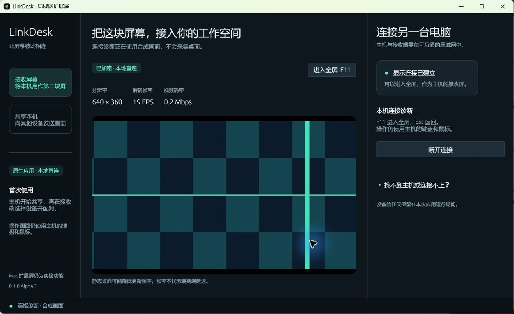

# LinkDesk

**原生、局域网、跨系统的投屏与扩展屏。目标是像随航一样，把另一台设备变成系统中的显示器。**

Native desktop applications, not a browser viewer or a WebView. Written in Rust, with an Objective-C++ macOS helper. MIT licensed; see third-party notices for dependencies and interface references.

> Development prototype. Native encrypted video transport and desktop rendering are implemented. macOS extension uses an experimental private display interface and requires real Mac validation. This is not a finished Sidecar replacement.

**Development downloads:** [macOS and Windows alpha packages](https://github.com/claudecorns12138-source/linkdesk/releases). These are native applications built in CI, not browser clients. Follow the pairing instructions below; real Mac extension and Sidecar coexistence remain unverified.

当前下载：[Alpha 6 的 Mac ARM64 与 Windows x64 安装包](https://github.com/claudecorns12138-source/linkdesk/releases/tag/v0.1.0-alpha.6)，均通过三平台 CI 检查后发布。网络协议保持兼容，已有 Windows Alpha 2 接收端也可继续使用；更新接收端可获得连接取消与首帧期限改进。真实 Mac + iPad 随航 + Windows 的共存与双向窗口拖动仍待实机验收。

## Alpha 6：取消连接与等待首帧

主机名称解析、建立连接、首次安全握手和确认指纹后的重连均可取消；取消会关闭本次连接，不再等握手超时后才退出。连接失败按名称解析、网络连接、安全握手、身份确认、配对和首帧阶段给出下一步提示。同一热点下连接不上时，提示检查主机、地址和设备隔离。

主机批准后，最多等待 15 秒接收并解码首帧；只收到零散数据也不会无限延长等待。成功解码后取消首帧期限，静态桌面不会因没有新画面而断开。仍须每次主机批准，局域网连接的首次指纹确认不能跳过。此轮不改变虚拟屏创建或随航排列。

## Alpha 5：共享中只读核对跨屏通路

Mac 共享中新增 **核对当前排列（只读取）**。移动、断开或重连随航后，点击核对可读取当前布局，显示公共边缘是否仍相接，并区分相邻屏离线／镜像、接收屏缺失／镜像、布局重叠和没有公共边缘。

排列图使用本次读取的实际坐标，不会把已离线屏幕的缓存位置继续当成有效通路，也不会自动改选主屏。用户自行把接收屏改到另一侧，只要仍有有效公共边缘，就按实际方向显示。每次结果标明读取后的时间；这是按需读取，不会自动移动屏幕、重连随航或改变镜像关系。

`--layout-preview` 增加上述状态的虚构布局演示；演示不代表 Mac 实机状态或三屏验收结果。

## Alpha 4：加固采集组件退出与取消

停止后拒绝并回收迟到的子进程，采集函数提前结束时自动清理；Mac 组件独立监测主程序退出，避免静态画面下遗留采集进程。共享内容查询改为同队列更新状态并限制等待时间，编码器错误会结束自有会话。macOS CI 用不访问显示器的测试模式验证了真实父进程退出后的组件退出；这些测试不替代随航实机验收。

## Alpha 3：保留随航，直接跨屏拖动

Mac、随航 iPad、LinkDesk Windows 组成同一个 Mac 桌面。目标是把 iPad 上的 Mac 窗口直接拖到 Windows 那块屏，再拖回来。

- 新增相邻屏幕与上下左右位置选择，原生排列预览标出可穿过的公共边缘。
- 自动规划优先贴着已有独立扩展屏；避开重叠区域，不再简单按主屏高度放到最右侧。
- 创建前后核对现有屏幕位置、逻辑／像素分辨率、刷新率、旋转、主屏和镜像状态。只配置自有虚拟屏；发生变化时中止本次扩展。
- 不断开或重配 iPad 随航；真实 Mac 上的无干扰与双向拖动仍需实机验收。

操作与验收步骤见 [保留随航的三屏 Mac 桌面](docs/CONTINUOUS_DESKTOP.zh-CN.md)。

### Alpha 2 的改进

- 中文原生界面：接收屏幕、共享本机分开，提供配对引导和可收起的错误详情。
- 连接失败或主机断开后可直接重试；旧会话的消息和画面不会覆盖新会话。
- 本次运行内记住已确认的主机指纹；身份变化仍须重新核对，每次连接仍须主机允许。
- 主机可断开指定接收屏，配对码过期提示、地址及配对码复制。
- 多网卡发现、IPv4 / IPv6 / 主机名输入，以及粘贴带空格的配对码。
- 显示实际解码帧率和视频码率；F11 / Esc 全屏切换。帧率不等于端到端延迟。
- 原生 WGPU 渲染，保留 OpenGL 启动回退；本机诊断可断开后重新运行，始终只发送合成画面。



Windows 原生调试窗口的实际截图：合成画面经过 H.264 编码、TLS 本机传输、解码和显示。这张截图不代表 Mac 实机扩展或端到端延迟已完成验收。

## Current scope

| Capability | Status |
| --- | --- |
| Native Windows / macOS / Linux receiver window | Implemented; platform build/validation results belong in `docs/VALIDATION.md` |
| Native H.264 decoding, full screen, latest-frame rendering | Implemented |
| LAN TLS encryption, fingerprint confirmation, expiring six-digit code, host approval | Implemented; confirmed fingerprints cached only in memory; host approval still required |
| LAN broadcast discovery; manual host IP fallback | Implemented; routed networks, VPNs and hotspot isolation may block discovery or connectivity |
| macOS independent extended display | Experimental helper: creates one display and captures it with ScreenCaptureKit / VideoToolbox |
| macOS native mirroring | Helper implemented; hardware validation pending |
| Windows primary-display mirroring | DXGI capture + software H.264 fallback implemented |
| Windows independent extended display | **Not implemented**; requires an IDD/IddCx driver and a signing/distribution path |
| iPad / iPhone / Android native clients | **Not implemented**; an existing Apple Sidecar connection can be kept separately |
| One independent virtual display per receiver | **Not implemented**; this prototype sends one source to up to four receivers |
| Receiver keyboard/touch input, audio, clipboard | **Not implemented** |

Wired Ethernet and Wi-Fi use the same IP transport. An ordinary USB-C or HDMI cable is not automatically a network connection or a video input.

## Build and run

Install a current stable Rust toolchain. The lockfile is committed. Building OpenH264 from source needs a C/C++ compiler; NASM is recommended. No external streaming service, account, STUN or TURN server is used.

### Windows

```powershell
git clone https://github.com/claudecorns12138-source/linkdesk.git
cd linkdesk
.\scripts\build-windows.ps1
.\dist\windows\linkdesk.exe
```

MSVC is recommended for distributable Windows builds. GNU development builds copy their toolchain runtime DLLs alongside the application.

### macOS

Install Xcode Command Line Tools and Rust, then:

```sh
git clone https://github.com/claudecorns12138-source/linkdesk.git
cd linkdesk
bash scripts/build-macos.sh
open dist/LinkDesk.app
```

This builds a development `.app` with an ad-hoc signature, not a notarized release. The Mac helper must remain beside the main executable inside the bundle. macOS 14.4+ is the development target, not a guarantee of compatibility with every newer OS.

### Linux receiver

Install the X11/Wayland/graphics development packages and a CJK system font such as Noto Sans CJK for your distribution, then `cargo run --locked`. Linux screen capture and virtual-display creation are not implemented. Receiving and synthetic connection tests use the native application.

## Mac → Windows extended desktop

1. 保留现有 iPad 随航。Mac 打开 **LinkDesk.app → 共享本机 → 扩展桌面**，刷新屏幕排列，选择对应 iPad 的 **相邻屏幕**与空闲的一侧，再 **开始共享**。
2. 如系统请求权限，请自行允许屏幕录制／本地网络。授权后仍不能采集时，退出应用再打开。
3. Windows 选择 **接收屏幕**，选中发现的主机，或手动填写 Mac 地址。地址可省略默认端口，也支持 IPv6 和主机名。
4. Mac 展开 **显示配对信息**，可复制地址、查看／刷新配对码。Windows 输入六位配对码并点 **连接主机**。
5. 首次连接，对照 Mac 的 **身份指纹**；确认一致后，Windows 点 **指纹一致，继续配对**，Mac 点 **允许连接**。同次应用运行中，相同指纹不再重复核对；主机确认仍保留。
6. Windows 点 **进入全屏** 或按 **F11**。Mac 到系统 **显示器**设置检查新增屏幕排列，再把一个窗口拖过去。仍使用 Mac 的键鼠操作；按 **Esc** 退出接收端全屏。
7. 沿排列图中的亮线，把随航 iPad 上的 Mac 窗口直接拖到 Windows 屏，再反向拖回。检查三块屏同时显示不同的 Mac 窗口。实机兼容性与随航并用仍待验收。

Stopping the Mac host terminates the helper and releases its virtual display. Move valuable work back to the main screen before experimenting with display removal. Capture is currently limited to a maximum 1080p, without automatic resolution negotiation or persisted device trust.

## Connection diagnosis

```sh
linkdesk --demo
```

This runs a native H.264 encoder → TLS loopback → native decoder → desktop rendering path in a single application. It uses generated video, captures no desktop, binds its host to loopback, and does not advertise it on the LAN. It proves local transport/rendering, **not** physical Mac extension, two-device network connectivity, or latency.

For an actual two-device test, choose **共享本机 → 连接诊断** on the host and pair the other device normally. This exercises real LAN connectivity without sharing private desktop content.

The default renderer uses native WGPU backends (Direct3D / Metal / Vulkan as available). OpenGL is retained as an initialization fallback; developers can force it with `linkdesk --opengl`. No web renderer is used. CJK fonts are loaded from the local operating system and are not uploaded or bundled from a user's computer.

TCP `47831` carries TLS; UDP `47832` carries discovery beacons. Permit the application on the intended local network when your OS asks. Do not disable the whole firewall. Same Wi-Fi name does not guarantee client-to-client connectivity; try manual IP, then a known working Ethernet/LAN path to isolate the cause.

## Development

```sh
cargo fmt --check
cargo clippy --locked --all-targets -- -D warnings
cargo test --locked --all-targets
python scripts/privacy_check.py --self-test
```

The build workflows compile native binaries and the macOS helper. CI is not a real-display acceptance test. See [architecture](docs/ARCHITECTURE.md), [roadmap](docs/ROADMAP.md), [validation](docs/VALIDATION.md), [security/privacy](SECURITY.md), and [third-party notices](THIRD_PARTY_NOTICES.md).
