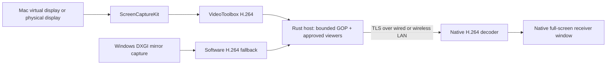

# Native architecture

The receiver is an eframe/winit desktop window. Its default WGPU renderer uses native graphics APIs; OpenGL is retained as a startup fallback. There is no HTML UI, browser capture, WebView, or web receiver.

## Real extension

Extension means the host OS creates a separately addressable display. The macOS helper uses `CGVirtualDisplay` via runtime lookup, sets a 1920×1080 mode, and asks ScreenCaptureKit to capture that display. A Mac window and cursor can move into it because it belongs to macOS's desktop layout. Receiving pixels alone never creates another desktop.

The private interface is isolated in `native/macos/capture.mm`; failure is reported rather than falling back silently to mirroring. Its experimental status must remain visible. ScreenCaptureKit and VideoToolbox are public capture/encoding frameworks. macOS and Sidecar compatibility requires hardware testing.

`desktop.rs` plans only the new display's rectangle, requiring at least a 64-unit shared edge with a selected active, independent display and no overlap with existing independent displays. Automatic selection prefers an existing extension such as Sidecar. The native helper revalidates the plan against a fresh topology before creation. `layout_guard.h` checks the existing screens' origins, logical/pixel modes, refresh, rotation, main/active and mirror states after creation and after the session-only configuration transaction. Only the newly created display ID is configured. A mismatch aborts the helper; no Sidecar restart, repair or global rearrangement is attempted. A successful local ready event supplies the startup topology to the native UI; that metadata is not carried over the LAN. Physical no-interference and direct window dragging remain acceptance requirements.

Windows extension needs a separate user-mode indirect display driver. There is no pretend adapter or `Win+P` shortcut in the application. Linux Wayland extension depends on compositor support; neither virtual-display nor capture adapters exist yet.

## Transport and pairing

1. Host generates a per-run ECDSA identity and an expiring random pairing code. Private keys stay in process memory.
2. Receiver probes the host certificate without sending application data. The user compares its SHA-256 fingerprint with the host.
3. Receiver reconnects, pins the exact certificate, validates TLS handshake signatures, and only then sends its pairing code and generic device name. Confirmed fingerprints are cached only in memory for that address; changed identities require confirmation again.
4. Host validates protocol/version/code and requires a local Allow decision before sending video. Pair attempts and concurrent handshakes are bounded.
5. H.264 Annex B frames travel in bounded, length-prefixed records over TCP/TLS. No cloud service or relay is configured.

This MVP uses a single TCP stream per receiver. Packet loss causes head-of-line blocking; it is not a guarantee of Sidecar latency. QUIC/datagram transport, hardware decoding, adaptive rate/resolution, and separate cursor transport are later work.

Records: big-endian u32 length (including kind byte), u8 kind, payload. Kind 1 is bounded JSON control, 2 is video, and 3 is a normalized capture error. Video payload: u64 sequence, u32 width, u32 height, u8 keyframe, Annex B bytes. Maximum record: 8 MiB; maximum advertised dimensions: 4096×2160; current capture target: ≤1920×1080.

No unbounded frame queue exists. Receivers render only the latest decoded frame. A host caches at most one bounded GOP for joining a static screen. A full receiver channel closes that stream rather than dropping a referenced inter-frame and continuing with corruption.

The UI uses a fresh event channel and frame slot for every receive attempt, so stale completion events or in-flight frames cannot overwrite a newer session. A completion event releases the busy state after connection failure. Host-side per-device disconnect closes its registered TCP socket, including pending requests; blocked receiver reads wake on shutdown. LAN beacons are sent through per-interface IPv4 broadcast sockets and refreshed after network changes, with a generic broadcast fallback.

Capture subprocess ownership is represented by a scope lease. Stopping the host permanently closes that control, kills and reaps its registered child, and rejects/reaps a child that finishes starting after cancellation. Returning or unwinding from Mac capture drops its lease, so cleanup does not depend on the UI polling an error. The Mac helper also checks parent identity on an independent utility-queue timer: a dead owner ends the helper even if a static desktop produces no more video frames. It never kills another application or reconfigures existing displays. Its `self-test-parent` mode exercises process ownership on macOS CI without enumerating screens, requesting capture permission, or creating a display. Shareable-content completion state is accessed on the main queue with a bounded monotonic deadline; late completions are ignored. Encoder preparation and callback errors are surfaced as capture failures.

## Primary references

- [Apple ScreenCaptureKit](https://developer.apple.com/documentation/screencapturekit)
- [Apple VideoToolbox](https://developer.apple.com/documentation/videotoolbox)
- [Chromium virtual display test implementation](https://chromium.googlesource.com/chromium/src/+/HEAD/ui/display/mac/test/virtual_display_util_mac.mm) — private interface reference, not Apple support or a stable SDK contract
- [Microsoft indirect display driver model](https://learn.microsoft.com/en-us/windows-hardware/drivers/display/indirect-display-driver-model-overview)
- [eframe native entry point](https://docs.rs/eframe/0.31.1/eframe/fn.run_native.html)
- [OpenH264 Rust wrapper](https://docs.rs/openh264/0.9.9/openh264/)
