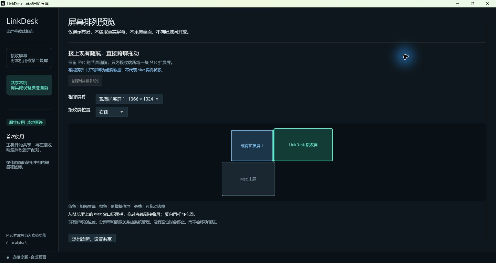

# 保留随航的三屏 Mac 桌面

目标：Mac 为主机，iPad 继续使用苹果随航，Windows 全屏显示 LinkDesk 新增的 Mac 扩展屏。把随航 iPad 上的 **Mac 窗口**直接拖到 Windows 那块屏，再拖回来。无需让 iPad 另装接收器或与 Windows 配对。

图示是桌面关系，网络传输仍分别为 Mac → 随航 iPad、Mac → LinkDesk Windows。窗口属于 Mac，Windows 用作显示终端。

以上是 Windows 上原生应用的布局演示截图，使用虚构屏幕数据；不是 Mac、iPad 和 Windows 实机连通证明。

## 使用步骤

1. 保持现有 iPad 随航为**扩展显示**，不需要断开或重新设置。
2. Mac 打开 LinkDesk，选择 **共享本机 → 扩展桌面**。
3. 点 **刷新屏幕排列**，在 **相邻屏幕**中选择对应 iPad 的现有扩展屏。用图中的位置和分辨率对应系统“显示器”里的排列；应用不会通过私有随航接口猜测设备身份。
4. 在 **接收屏位置**中选 Windows 实际摆放的一侧。绿色屏框代表新增 LinkDesk 屏，亮线代表能直接穿过的公共边缘。也可先选“自动选择空闲边缘”。
5. 开始共享，按 README 在 Windows 配对并全屏。主机显示保护检查通过后，先测试一个不含敏感内容的普通 Mac 窗口。
6. 使用 Mac 的鼠标或触控板，抓住该窗口的标题栏，从 iPad 屏拖过图中亮线，进入 Windows 屏；反向可拖回。原生全屏 App 建议先退出全屏再拖动。

选择的边缘被占用时，LinkDesk 会报错，请选另一侧。不会为腾出空位而移动 iPad 或其他现有显示器。开始共享时会重新读取并验证屏幕状态，因此预览期间断开、重连或移动随航后，需要刷新并重新选择。

预览不是物理测试结果。共享中的排列图记录启动时的状态；用户随后手动修改系统排列时，以系统“显示器”设置为准。

## 随航保护的实现边界

- 在创建虚拟显示器前记录现有在线屏幕的坐标、逻辑与像素分辨率、刷新率、旋转、主屏、启用和镜像状态。
- 几何规划只计算新屏位置。要求与指定屏幕有至少 64 个桌面坐标单位的公共边缘，并避开现有独立桌面区域。
- 原生采集组件在创建和配置后分别核对现有状态。配置 API 只作用于本进程新建的显示器，使用会话级配置。
- 若现有状态变化、所选屏幕离线或位置被占用，则中止本次扩展，退出本进程采集组件。不尝试恢复、重排或控制随航，也不自动断开／重连 iPad。
- 结束共享只终止自有采集组件，释放自有虚拟屏。macOS 仍可能把该虚拟屏中的窗口移回其他显示器；这是需要实机验收的系统行为。
- 这些检查不能保证 macOS 或私有虚拟显示接口完全没有瞬时影响。与已有随航并用的稳定性必须在真实 Mac 上验证，不能以几何测试、编译成功或演示截图代替。

屏幕列表仅在本机内存中使用，不写入配置文件，也不发送给接收端。不修改 AirPlay、Apple Account、随航配置、键鼠控制或其他屏幕模式。

## 实机验收

- [ ] 启动前后，原有 iPad 随航始终在线；位置、分辨率、缩放、刷新率和镜像状态一致。
- [ ] Mac、iPad、Windows 同时显示三个不同的 Mac 窗口。
- [ ] 将同一个普通 Mac 窗口从 iPad 直接拖到 Windows，再反向拖回；不必先绕回 Mac 主屏。
- [ ] 分别验证 iPad 在主屏左、右、上、下方，以及边缘被其他屏幕占用时的失败处理。
- [ ] Windows 连接／断开／重连期间，现有随航会话保持工作；网络故障不触发随航重配。
- [ ] 结束 LinkDesk 后，只有 LinkDesk 虚拟屏移除，iPad 随航仍可使用。
- [ ] 有线、Wi-Fi、当前热点分别完成不少于 30 分钟的窗口拖动与编辑使用；记录本地结果，公开反馈前脱敏。

当前未实现 iPad 原生 App 搬到 Windows、Windows 本机 App 搬到 iPad，或跨操作系统的原生文件拖放。这些不属于同一个 Mac 桌面的窗口移动。

开发者可运行 `linkdesk --layout-preview` 查看虚构三屏数据的原生布局预览；不会读取真实屏幕、创建虚拟屏、捕获桌面或启动 LAN 主机。

依据：[Apple 随航说明](https://support.apple.com/en-us/102597)、[显示器原点配置 API](https://developer.apple.com/documentation/coregraphics/cgconfiguredisplayorigin(_:_:_:_:))。Apple 说明支持随航上的 Mac 窗口移动；LinkDesk 与随航并用是本项目需要单独验收的组合。
